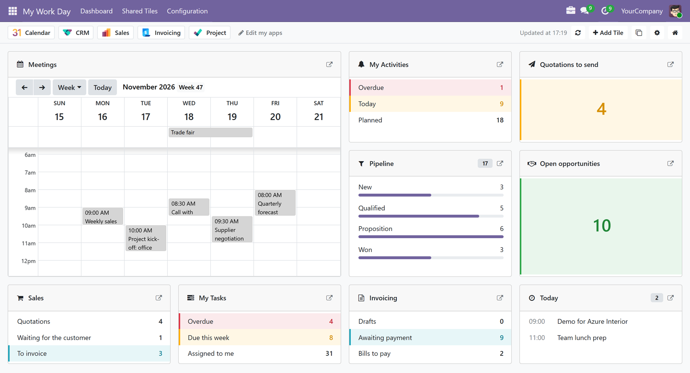

# My Work Day

A personal daily dashboard for **Odoo 19 Community**. Instead of the app switcher, each
user lands on a page that shows the work actually waiting for them: overdue activities,
quotations to follow up, invoices that need a reminder, this week's meetings, tasks
that are running late.



## Why

Odoo opens on a grid of apps: it tells you where things are, not what needs doing. So the
day starts with a tour of the menus — Sales, filter the quotations to send; Invoicing,
look for overdue invoices; Project, find the late tasks — and what matters is different
for every job. A salesperson, an accountant and a project manager each rebuild their own
set of filters, every day, from memory. It is slow, and a filter forgotten on a busy
morning is a customer who waits another week.

My Work Day puts that tour on one page. Each person sees the numbers that matter for
their work, what needs attention stands out, and every number opens the records behind
it, ready to work on. Tiles are built with Odoo's own filter builder, without code, and
a good one can be shared with colleagues in a click.

## Setup

```bash
odoo-bin -d <database> --addons-path=<odoo>/addons,<this repo> -i my_work_day
```

1. Under *My Work Day → Configuration → Selectable Models*, choose what people may build
   tiles on.
2. Give the *Editor* access level to the people who build their own dashboard; everyone
   else reads the one prepared for them.
3. Optionally, in *Settings → My Work Day*, make the dashboard everyone's landing page,
   set how often it refreshes, and cap how many tiles a dashboard may hold.

## How it works

The dashboard is a client action. On load it makes a single call,
`mwd.dashboard.get_dashboard_data()`, which counts every tile on the server with the
user's own access rights and returns plain JSON; the OWL component only draws it. A
click asks the tile for an action (`action_open_line`, `action_open_tile`, ...): an
ordinary `act_window` filtered to what was clicked, or the linked app menu's own action.

```
my_work_day/
├── models/
│   ├── mwd_dashboard.py       one dashboard per user, starter tiles, the page payload
│   ├── mwd_tile.py            a tile: its type, counting, click-through, limits, health check
│   ├── mwd_tile_line.py       one named filter of a Counters tile, with its colour rule
│   ├── mwd_allowed_model.py   the administrator's list of selectable models
│   ├── filter_expression.py   evaluates a tile filter as data, from a fixed grammar
│   ├── ir_model.py            lets a record rule ask "is this model selectable?"
│   ├── ir_ui_menu.py          finds the menus that open a given model
│   ├── ir_http.py             session flags: landing page, systray icon
│   └── res_users.py, res_config_settings.py
├── security/                  Reader < Editor < Administrator, access rights, record rules
├── views/                     tile and dashboard forms, admin lists, settings, menus
├── static/src/dashboard/      the OWL dashboard, tiles, calendar tile, icon and app pickers
├── static/src/systray/        the systray shortcut
└── tests/                     built on res.partner, so they run on a bare database
```

To run the tests:

```bash
odoo-bin -d <database> --addons-path=<odoo>/addons,<this repo> -u my_work_day --test-enable --test-tags=/my_work_day --stop-after-init
```

On Windows with Git Bash, prefix that with `MSYS_NO_PATHCONV=1`, or `/my_work_day` is
turned into a Windows path and no test runs.

## Licence

MIT — see [LICENSE](LICENSE).
